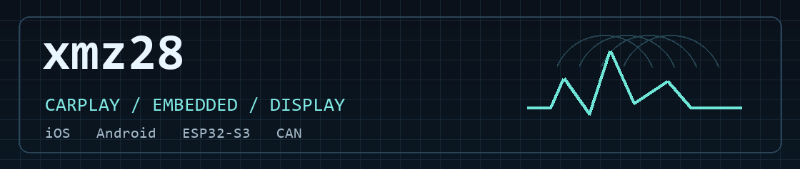
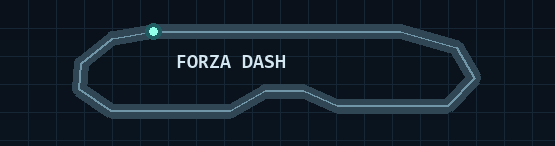

**English** · [简体中文](README.zh-CN.md)

I build CarPlay receivers, screen-sharing apps, and embedded displays. My projects span iPhone, Android, Windows, and ESP32.

## Featured projects

| Project | What it does |
| --- | --- |
| **[CarWithin](https://github.com/xmz28/CarWithin)** | Run and control CarPlay on the same iPhone, or cast to a local browser, a wireless CarLife receiver, or a compatible dashboard. [Download IPA](https://github.com/xmz28/CarWithin/releases/latest) |
| **[Ninebot Pro](https://github.com/xmz28/ninebot_pro)** | Cast photos, videos, and camera feeds from Android or iOS to compatible dashboards. Android also supports phone screen mirroring. [Downloads for Android and iOS](https://github.com/xmz28/ninebot_pro/releases/latest) |
| **[TetherPin](https://github.com/xmz28/tetherpin-ios)** | Windows tool for sending a location selected on OpenStreetMap to an iPhone over USB. [Download for Windows](https://github.com/xmz28/tetherpin-ios/releases/latest) |
| **[Carplay-S3](https://github.com/xmz28/Carplay-S3)** | Experimental wired CarPlay receiver for ESP32-S3 with software H.264 decoding, an RGB display, and GT911 touch. [Firmware and installation](https://github.com/xmz28/Carplay-S3/releases/latest) |

## Tools and platforms

     

[Support my projects](https://github.com/xmz28/support)
