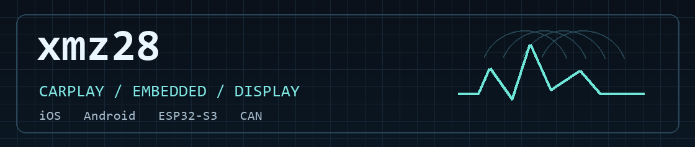
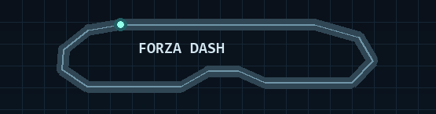

[English](README.md) · **简体中文**

我做车载显示、投屏和嵌入式项目，从 iPhone 上的 CarPlay，到 ESP32-S3 上的一块触屏。

## 精选项目

| 项目 | 用途 |
| --- | --- |
| **[CarWithin](https://github.com/xmz28/CarWithin)** | 在同一台 iPhone 上生成并显示 CarPlay，也可以从局域网浏览器查看和操作。[下载 IPA](https://github.com/xmz28/CarWithin/releases/latest) |
| **[Ninebot Pro](https://github.com/xmz28/ninebot_pro)** | 通过 Wi-Fi Direct 将图片、视频、摄像头或手机屏幕投到兼容的九号仪表。[下载 APK](https://github.com/xmz28/ninebot_pro/releases/latest) |
| **[ForzaDash](https://github.com/xmz28/ForzaDash)** | 将 Forza 游戏遥测通过 Wi-Fi 投屏或 ESP32 CAN 中继显示到实体仪表。[Windows 软件与 ESP32 固件](https://github.com/xmz28/ForzaDash/releases/latest) |
| **[Moonlight-S3](https://github.com/xmz28/Moonlight-S3)** | 把 Windows 桌面串流到 ESP32-S3 触屏，并把触控回传给电脑。[配套 Windows 软件](https://github.com/xmz28/Moonlight-S3-Host) |

## 技术方向

   

